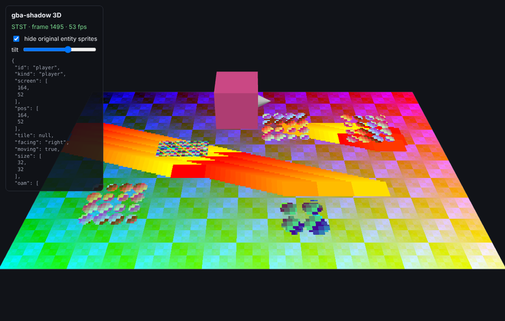

# gba-shadow

Prototype that runs a GBA game in mGBA and draws a second, "shadow" view of it
from the live display state (sprite attributes, tiles, palettes, scroll
registers), so that graphics can be swapped for your own art at higher
resolution.

```
┌──────────── mGBA ────────────┐   TCP 127.0.0.1:61337   ┌──────── python -m shadow view ────────┐
│ game runs as normal           │  ~2 KiB/frame (diffed)  │ mirror of IO/palette/VRAM/OAM          │
│ lua/shadow_bridge.lua reads   │ ──────────────────────► │ renderer: exact 1x re-render           │
│ IO regs, palette, VRAM, OAM   │                         │  + replacement art from a pack at S×   │
│ once per frame                │                         │ pygame window                          │
└───────────────────────────────┘                         └────────────────────────────────────────┘
```


*Left: mGBA's output. Right: the shadow view at 4x with an auto-generated demo
pack (Scale2x + outlines). The test ROM's graphics are deliberately noisy test
patterns.*

## What works

- **Bridge** (`lua/shadow_bridge.lua`): mGBA Lua script that streams the display
  state every frame. It sends only the 1 KiB chunks that changed, never blocks
  the emulator (frames are dropped while the viewer is busy), and reconnects
  automatically. Cost inside mGBA is about 1 ms/frame.
- **Reference renderer** (`shadow/render.py`): rebuilds the frame from that
  state. It covers modes 0–5, text and affine BGs, 4bpp/8bpp, 1D/2D OBJ mapping,
  normal/affine/double-size sprites, flips, priorities, windows (WIN0/WIN1/OBJ
  window) and alpha, brighten and darken blending. **At 1x it matches mGBA pixel for pixel**
  (122/122 captured test frames).
- **Content-hashed replacements** (`shadow/pack.py`): every sprite and 8x8 BG tile is
  identified by a hash of its pixels (+ a hash of its palette), not by OAM slot or
  VRAM address, which games reshuffle constantly. Drop a PNG named by that hash into
  a pack and it is drawn instead, at any resolution.
- **Dump mode**: writes every never-seen-before sprite/tile as a PNG named by
  its hashes, so you can collect a game's graphics just by playing it.
- **Viewer** (`python -m shadow view`): live window with sprite-box overlay,
  replacement toggle and screenshots.
- **Entities** (`shadow/games/`): per-game adapters read the game's own objects
  from work RAM and turn them into entities (position, tile, facing, moving, and
  the sprite slots that draw them). Included: **Pokémon Emerald (US), player
  only**, and the test ROM.
- **WebSocket output + 3D demo** (`python -m shadow serve`): publishes every
  frame plus its entities. A three.js page lays the game screen flat and stands a
  cube on each entity in place of its sprite.

## Quick start

Requirements: mGBA **0.10 or newer** (needs scripting support), Python 3.10+.

```bash
pip install -r requirements.txt
```

```bash
python -m shadow view
```

Then in mGBA, load your ROM and open **Tools → Scripting… → File → Load script**,
and pick `lua/shadow_bridge.lua`. The view appears within a second. The order doesn't
matter: the script retries the connection every 60 frames.

Viewer keys: **B** sprite boxes (green = replaced, yellow = original, blue = OBJ window),
**R** toggle replacements, **S** screenshot, **Esc** quit.

## Making replacement graphics

1. Play the game with dumping on:

   ```bash
   python -m shadow view --dump dumps/mygame
   ```

   Add `--dump-tiles` to collect BG tiles too. Every sprite lands in
   `dumps/mygame/sprites/<pixhash>-<palhash>.png`, and `index.csv` records the
   first frame each one appeared in.
2. Copy the files you want to replace into a pack, then redraw them at any size.
   They are resized to *sprite size × scale* when loaded:

   ```
   packs/mygame/
     pack.json            {"scale": 4}
     sprites/<pixhash>-<palhash>.png   ← only this palette variant
     sprites/<pixhash>.png             ← every palette (rename to drop the -palhash)
     tiles/<pixhash>-<palhash>.png     ← one 8x8 BG tile, drawn at 32x32 for scale 4
   ```

   Alpha < 128 is transparent. Flips, rotation/scaling, priorities, windows and
   blending are applied to the replacement exactly as to the original.
3. View with the pack:

   ```bash
   python -m shadow view --pack packs/mygame
   ```

`tools/make_demo_pack.py DUMP_DIR PACK_DIR` turns a dump into a test pack
(Scale2x + outlines). It's useful for checking the pipeline before you have real art.

## Entities and 3D

```bash
python -m shadow serve
```



Load the bridge in mGBA as usual and open http://127.0.0.1:8765. The game
screen is drawn as a floor with the player's sprite removed, and a cube with a
"nose" stands where the player is, turning with the player's facing and bobbing
while walking. The panel shows the live entity data. The page loads three.js
from jsDelivr, so the browser needs internet access.

In the pygame viewer (`python -m shadow view`) the same entities are drawn as
an overlay: **E** toggles the overlay and **H** hides the entities' sprites.

**How it fits together**

1. When the bridge connects it sends a *hello* with the ROM's game code
   (e.g. `BPEE`).
2. The renderer looks up an adapter for that code (`shadow/games/`) and replies
   with the work-RAM ranges the adapter needs. The bridge then streams those
   ranges every frame, diffed like video memory.
3. Each frame, the adapter turns the mirrored RAM into `Entity` objects
   (`shadow/entities.py`):

   | field    | meaning |
   |----------|---------|
   | `id`, `kind` | stable id (`"player"`) and type |
   | `screen` | anchor point on the GBA screen (middle of the feet) |
   | `pos`    | the same point in world pixels (Emerald: map pixels, origin at the map's top-left) |
   | `tile`   | the tile the game thinks the entity is on |
   | `facing`, `moving` | `"down"`/`"up"`/`"left"`/`"right"`, walking or not |
   | `size`   | sprite size in GBA pixels |
   | `oam`    | hardware sprite slots that draw this entity (what to hide) |
   | `props`  | everything else the adapter knows |

4. `serve` sends one binary WebSocket message per frame on `/ws`:
   `u32 json_length | JSON | RGBA 240x160`. The JSON is the entity list,
   camera, game code and frame number. The image is the frame re-rendered with
   the entities' sprites removed (send `{"hide_entity_sprites": false}` to keep
   them). Any engine (Godot, Unity, Bevy, three.js...) can consume it.
   `shadow/server.py` has `decode_frame()` for Python clients.

**Timing.** Pokémon, like most games, runs its logic and then copies sprite
positions to the hardware in the *next* VBlank. RAM read at VBlank is therefore
one frame ahead of the picture. Adapters declare this (`ram_delay = 1`), and the
bridge then sends RAM from the previous frame along with the current picture.
The test ROM does the same, and a test checks that with the delay the entity
matches its sprite on every frame (and without it, it doesn't).

**Pokémon Emerald adapter** (`shadow/games/pokeemerald.py`)

- US English Emerald only (game code `BPEE`). Addresses come from the
  [pret/pokeemerald](https://github.com/pret/pokeemerald) decompilation's symbol
  map. Other languages need their own addresses.
- Player only, and only while the overworld is running (`gMain.callback2 ==
  CB2_Overworld`). There are no entities in battles or menus.
- `pos` is exact and smooth. It's derived from the sprite position and the
  camera's scroll counters the same way the game places field sprites. It
  changes frame of reference when you cross into a connected map (the `map`
  prop changes at the same moment).
- `props` include the previous tile, bike/surf/dash flags, elevation, graphics
  id, ledge-jump offset and the sprite's animation number and frame.
- The decompilation's struct layouts and formulas are covered by tests with
  hand-built memory. **It hasn't been run against a real Emerald ROM yet**, so
  expect to adjust things on the first real run. `python -m shadow entities
  capture.gbsh --game BPEE` prints what the adapter sees in a capture (set
  `SHADOW_WATCH` for captures, see the bridge's header).

**Writing an adapter.** Add a module to `shadow/games/` with an object that has
`name`, `game_codes`, `ram_ranges` (bus address, length), `ram_delay`, and
`extract(state) -> (entities, camera)`. Read memory with `state.u8/s16/u32(...)`
at bus addresses: reading anything not in `ram_ranges` raises, so missing
ranges show up immediately. Then register it in `shadow/games/__init__.py`.
`shadow/games/shadowtest.py` is the smallest example.

## Checking the renderer against mGBA

The bridge can also save full snapshots plus mGBA's own screenshot of the same
frame. Set `capture_dir` in the `CONFIG` table at the top of the script (or set
the `SHADOW_CAPTURE_DIR` / `SHADOW_CAPTURE_EVERY` / `SHADOW_CAPTURE_COUNT`
environment variables for mGBA), then:

```bash
python -m shadow verify path/to/captures
```

Mismatching frames get a `diff/` image (mGBA | ours | difference). Running this
against your target game is the quickest way to find features it uses that the
renderer doesn't handle yet. Also useful:

```bash
python -m shadow render capture.gbsh -o out.png --scale 4 --pack packs/mygame
```

## Test ROM, headless runner, tests

No commercial ROM is needed for development:

- `testrom/`: a small homebrew ROM (C, built with the stock `gcc-arm-none-eabi`)
  that cycles through every video mode and the sprite, window and blending features
  above. It also keeps a one-entry entity table in RAM for testing adapters.
  A prebuilt `shadowtest.gba` is included.
- `harness/shadow-run`: runs a ROM plus a Lua script under libmgba with no GUI,
  using the same scripting API as mGBA's Qt frontend. It's used for automated
  captures and the end-to-end test.

```bash
sudo apt install gcc-arm-none-eabi libmgba-dev mgba-qt   # Debian/Ubuntu
```

```bash
make            # builds testrom/shadowtest.gba and harness/shadow-run
```

```bash
make selftest   # captures ~120 frames headlessly and verifies them against mGBA
```

```bash
make test       # pytest: renderer vs mGBA fixtures, packs/dumps, protocol, entities, bridge end-to-end
```

## Performance (this machine, NumPy renderer)

| configuration                          | ms / frame |
|----------------------------------------|-----------:|
| 1x, no pack                            | ~13        |
| 4x, no pack (upscaled 1x)              | ~15        |
| 4x, all sprites replaced               | ~65        |
| 2x, all sprites + every BG tile        | ~60        |
| 4x, all sprites + every BG tile        | ~250       |

The renderer computes the exact 1x frame first and then redoes, at high
resolution, only the pixels covered by replacement art. So cost grows with how
much is replaced, not with output size. Sprite-only packs are usable at 2x–3x,
but a full HD pack at 60 fps needs the GPU port listed below.

## Known limitations / next steps

- **Mid-frame effects are lost.** State is sampled once per frame (at VBlank), so
  HBlank-DMA/IRQ raster effects (wavy water, per-line scroll, Mode 7 floors, split
  HUD palettes) render with the last value written. Fixing this means capturing
  per scanline, either by embedding libmgba and hooking its scanline renderer or
  by having the renderer replay a per-line register log.
- **GPU renderer.** The NumPy renderer is the reference (exact, easy to test).
  For real-time HD, port the same rules to a fragment shader: VRAM, palette and
  OAM as textures, replacements as an atlas.
  The hashing/plan step stays on the CPU.
- **Bitmap modes (3–5)** aren't replaceable (there are no tiles to identify), and
  **mosaic** and the per-line sprite pixel budget aren't emulated.
- **More entities.** The Emerald adapter only covers the player. NPCs are the
  same `gObjectEvents` table (and the same maths), so they're the natural next
  step, followed by a RAM inspector tool for games without a decompilation.
- **Metasprites.** Sprite *replacements* are still per OAM entry. Entities
  already know all the slots that draw them, so whole-character replacements
  can build on that.
- Tested headlessly against libmgba 0.10.2 (same scripting engine as the GUI),
  not yet inside the mGBA Qt app on a desktop.

## Layout

```
lua/shadow_bridge.lua   mGBA script: state + RAM streaming, capture mode
shadow/                 Python package (python -m shadow …)
  protocol.py           wire format, TCP receiver (hello/watch), capture loading
  state.py              GBA display state, watched RAM, register accessors
  render.py             reference renderer + replacement compositing
  pack.py               hashing, replacement packs, dumper
  entities.py           Entity / World model, adapter interface
  games/                game adapters (pokeemerald.py, shadowtest.py)
  session.py            bridge connection + adapter selection
  server.py             WebSocket server (python -m shadow serve)
  web/index.html        three.js demo client
  viewer.py             pygame window
  verify.py             renderer-vs-mGBA comparison
tools/make_demo_pack.py demo pack generator
testrom/                homebrew test ROM (C)
harness/                headless libmgba runner (C)
tests/                  pytest suite + mGBA capture fixtures
```

### Wire format

Little endian. Header `"GBSH" u8 version u8 flags u16 count u32 frame u32 payload_len`,
followed by `count` records of `u8 region u32 offset u32 length` + bytes. Regions:
0 = I/O registers (first 0x60 bytes), 1 = palette, 2 = VRAM, 3 = OAM, 4 = EWRAM,
5 = IWRAM (offsets relative to the region). Flag bit 0 marks a full snapshot. Flag bit 1
marks a *hello*: its payload is two length-prefixed strings (game code, title) and it
has no records. `.gbsh` capture files are a single full-snapshot message.

The renderer answers a hello with a watch request:
`"GBSW" u8 version u8 flags u16 count`, then `count` × `u32 bus_address u32 length`.
Flag bit 0 asks for RAM to be delayed by one frame. A new request replaces the old one.
